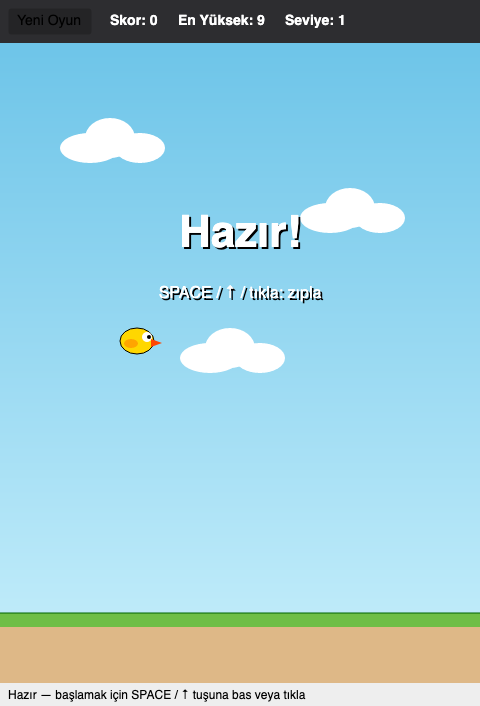

# YMH219 - Flappy Bird

Nesne Tabanlı Programlama (YMH 219) dersi ek uygulama ödevi. Windows Forms üzerinde, Timer ile çalışan bir oyun döngüsü ve klavye olayları kullanılarak geliştirilmiş Flappy Bird benzeri bir masaüstü oyunu.

Kuş, tuşa basıldığında yukarı zıplar ve yer çekimiyle aşağı düşer. Amaç, sağdan sola gelen boruların arasındaki boşluklardan geçerek puan toplamaktır.

## Kullanılan Teknolojiler

- C# / .NET 8 (`net8.0-windows`)
- Windows Forms
- GDI+ (`System.Drawing`) ile çizim
- Harici NuGet paketi kullanılmamıştır.

## Kurulum ve Çalıştırma

**Gereksinimler:** Windows 10/11, Visual Studio 2022 (".NET masaüstü geliştirme" iş yükü) veya .NET 8 SDK.

Visual Studio ile:

1. Depoyu klonlayın: `git clone https://github.com/<kullanici-adi>/YMH219-FlappyBird.git`
2. `FlappyBird.sln` dosyasını Visual Studio ile açın.
3. `F5` ile derleyip çalıştırın.

Komut satırı ile:

```bash
dotnet run --project FlappyBird
```

## Kontroller

| Tuş | İşlev |
|---|---|
| `Space` / `↑` / `W` / sol tık | Zıpla (hazır ekranında oyunu başlatır) |
| `Enter` / `R` | Oyun bittikten sonra yeniden başlat |
| **Yeni Oyun** butonu | Oyunu her an sıfırdan başlat |

## Özellikler

- Yer çekimi ve zıplama fiziği; kuş hızına göre yukarı/aşağı eğilir.
- Sürekli sağdan sola hareket eden 3 boru çifti; ekrandan çıkan boru rastgele yeni bir boşluk yüksekliğiyle en sağa taşınır.
- Boruya veya zemine çarpınca oyun durur ve **Game Over** ekranı gösterilir.
- Her geçilen boru için 1 puan.
- Her 5 puanda bir seviye atlanır ve oyun hızlanır.
- En yüksek skor dosyada saklanır ve uygulama yeniden açıldığında korunur.
- Üst çubukta skor, en yüksek skor ve seviye; alt durum çubuğunda oyun durumu ve hız gösterilir.

## Proje Yapısı

```
FlappyBird/
├── Program.cs              Uygulamanın giriş noktası
├── MainForm.cs             Arayüz, Timer döngüsü, klavye olayları ve çizim
├── GameCanvas.cs           Titreşimsiz (double-buffered) çizim yüzeyi
└── Models/
    ├── GameObject.cs       Konumu olan ve çizilebilen nesnelerin soyut taban sınıfı
    ├── Bird.cs             Kuş: yer çekimi, zıplama, çarpışma kutusu
    ├── PipePair.cs         Üst/alt boru çifti: hareket, yeniden konumlanma, çarpışma
    ├── GameManager.cs      Oyun kuralları: durum, skor, seviye, hız, çarpışma kontrolü
    └── HighScoreStore.cs   En yüksek skoru dosyaya okuma/yazma
```

`GameManager` arayüzden bağımsızdır: form yalnızca her Timer tick'inde `Update()` çağırır, `ScoreChanged` ve `StateChanged` olaylarını dinleyerek etiketleri günceller.

## Ekran Görüntüleri

| Başlangıç | Oyun | Game Over |
|---|---|---|
|  |  |  |

## Bilinen Sınırlamalar / Geliştirme Notları

- Oyun döngüsü `System.Windows.Forms.Timer` ile çalışır (20 ms aralık); bu zamanlayıcının çözünürlüğü sınırlı olduğundan kare hızı bilgisayara göre hafifçe değişebilir.
- Oyun alanı sabit boyuttadır (480×640); pencere yeniden boyutlandırılamaz.
- Ses efekti yoktur.
- En yüksek skor `%LOCALAPPDATA%\YMH219-FlappyBird\highscore.txt` dosyasında tutulur. Dosyaya erişilemezse kullanıcıya uyarı gösterilir ve oyun skor kaydetmeden devam eder.

## Öğrenci

- **Ad Soyad:** _<Adınız Soyadınız>_
- **Öğrenci No:** _<Öğrenci numaranız>_
