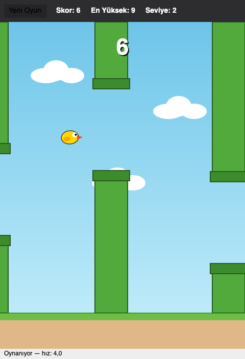
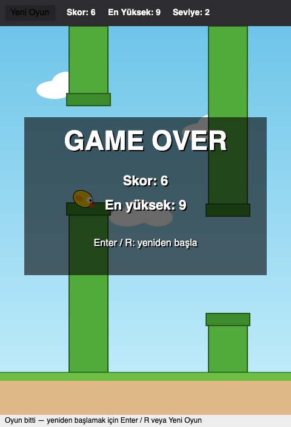

# YMH219 - Flappy Bird

Nesne Tabanlı Programlama (YMH 219) dersi ek uygulama ödevi. Avalonia UI ile, zamanlayıcı (DispatcherTimer) ile çalışan bir oyun döngüsü ve klavye olayları kullanılarak geliştirilmiş Flappy Bird benzeri bir masaüstü oyunu. Windows, macOS ve Linux'ta çalışır.

Kuş, tuşa basıldığında yukarı zıplar ve yer çekimiyle aşağı düşer. Amaç, sağdan sola gelen boruların arasındaki boşluklardan geçerek puan toplamaktır.

## Kullanılan Teknolojiler

- C# / .NET 8
- [Avalonia UI](https://avaloniaui.net/) 11.2 — çapraz platform masaüstü arayüz kütüphanesi
- NuGet paketleri: `Avalonia`, `Avalonia.Desktop`, `Avalonia.Themes.Fluent`
- Çizim: Avalonia `DrawingContext` (özel `Control` üzerinde `Render`)

> Ders föyünde ortam olarak Windows Forms belirtilmiştir; dersin hocasından WinForms'un zorunlu olmadığı onayı alınarak macOS'ta da çalışabilmesi için Avalonia tercih edilmiştir.

## Kurulum ve Çalıştırma

**Gereksinimler:** [.NET 8 SDK](https://dotnet.microsoft.com/download) (Windows, macOS veya Linux). NuGet paketleri ilk derlemede otomatik indirilir.

Komut satırı ile:

```bash
git clone https://github.com/insaninsan/Flappy-Bird.git
cd Flappy-Bird
dotnet run --project FlappyBird
```

Visual Studio 2022 / JetBrains Rider ile: `FlappyBird.sln` dosyasını açıp çalıştırın.

## Kontroller

| Tuş | İşlev |
|---|---|
| `Space` / `↑` / `W` / sol tık | Zıpla (hazır ekranında oyunu başlatır) |
| `Enter` / `R` | Oyun bittikten sonra yeniden başlat |
| `P` / `Esc` | Oyunu duraklat / devam ettir (pencere arka plana geçince oyun kendiliğinden duraklar) |
| **Yeni Oyun** butonu | Oyunu her an sıfırdan başlat |

## Özellikler

- Yer çekimi ve zıplama fiziği; kuş hızına göre yukarı/aşağı eğilir.
- Sürekli sağdan sola hareket eden 3 boru çifti; ekrandan çıkan boru rastgele yeni bir boşluk yüksekliğiyle en sağa taşınır.
- Boruya veya zemine çarpınca oyun durur ve **Game Over** ekranı gösterilir.
- Her geçilen boru için 1 puan.
- Her 5 puanda bir seviye atlanır ve oyun hızlanır.
- Oyun P / Esc ile duraklatılıp devam ettirilebilir; başka bir pencereye geçildiğinde kendiliğinden duraklar.
- En yüksek skor dosyada saklanır ve uygulama yeniden açıldığında korunur.
- Üst çubukta skor, en yüksek skor ve seviye; alt durum çubuğunda oyun durumu ve hız gösterilir.

## Proje Yapısı

```
FlappyBird/
├── Program.cs              Uygulamanın giriş noktası
├── App.axaml(.cs)          Uygulama ve tema tanımı
├── MainWindow.axaml        Pencere düzeni: üst bilgi çubuğu, oyun alanı, durum çubuğu
├── MainWindow.axaml.cs     Zamanlayıcı döngüsü, klavye/fare olayları, bilgi güncelleme
├── GameCanvas.cs           Oyunun çizildiği özel kontrol (arka plan, zemin, yazılar)
└── Models/
    ├── GameObject.cs       Konumu olan ve çizilebilen nesnelerin soyut taban sınıfı
    ├── Bird.cs             Kuş: yer çekimi, zıplama, çarpışma kutusu
    ├── PipePair.cs         Üst/alt boru çifti: hareket, yeniden konumlanma, çarpışma
    ├── GameManager.cs      Oyun kuralları: durum, skor, seviye, hız, çarpışma kontrolü
    └── HighScoreStore.cs   En yüksek skoru dosyaya okuma/yazma
```

`GameManager` arayüzden bağımsızdır: pencere yalnızca her zamanlayıcı tick'inde `Update()` çağırır, `ScoreChanged` ve `StateChanged` olaylarını dinleyerek etiketleri günceller.

## Ekran Görüntüleri

| Başlangıç | Oyun | Game Over |
|---|---|---|
|  |  |  |

## Bilinen Sınırlamalar / Geliştirme Notları

- Oyun döngüsü `DispatcherTimer` ile 20 ms aralıkla çalışır; fizik kare başına hesaplandığından kare hızı düşerse oyun da yavaşlar.
- Oyun alanı sabit boyuttadır (480×640); pencere yeniden boyutlandırılamaz.
- Ses efekti yoktur.
- En yüksek skor kullanıcının yerel uygulama veri klasöründe tutulur (Windows: `%LOCALAPPDATA%\YMH219-FlappyBird\highscore.txt`, macOS/Linux: `~/.local/share/YMH219-FlappyBird/highscore.txt`). Dosyaya erişilemezse durum çubuğunda uyarı gösterilir ve oyun skor kaydetmeden devam eder.

## Öğrenci

- **Ad Soyad:** Şerif Bayram
- **Öğrenci No:** 225541018
